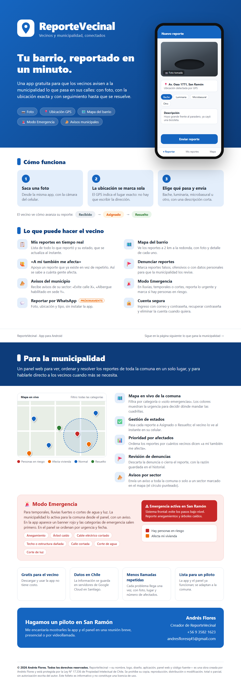

# Reporte Vecinal

App Android para que los vecinos reporten problemas urbanos a la municipalidad: socavones/baches,
luminarias apagadas, microbasurales y otros.



> Proyecto personal de Andrés Flores ([github.com/AndressFlorees25](https://github.com/AndressFlorees25)). App Android en Kotlin + panel web para municipalidades, con Firebase. Todos los derechos reservados.

## Funcionalidades (MVP)

- **Login / registro** con correo y contraseña (Firebase Auth), con «¿Olvidaste tu contraseña?».
- **Nuevo reporte**: foto con la cámara (CameraX), ubicación GPS automática, categoría y descripción.
- **Mis reportes**: lista en tiempo real con el estado de cada reporte (Recibido, Asignado, Resuelto).
  Menú ⋮ con «Cerrar sesión» y **«Eliminar mi cuenta»** (exigido por Play Store): pide la contraseña,
  deja los reportes anónimos (`uid = "cuenta-eliminada"`) y borra la cuenta.
- **Mapa**: reportes en 2 km a la redonda sobre OpenStreetMap (osmdroid, sin API key). Al tocar un pin
  se ve el detalle y se puede **denunciar** (falso, ofensivo, datos personales u otro) en la colección
  `denuncias` (una por vecino y reporte). En el panel web, admin y operadores las revisan en «Denuncias»
  (o en el detalle del reporte): **descartar** (el reporte sigue) o **cerrar el reporte** (pasa a Resuelto
  con la razón en el historial y deja de verse en el mapa de los vecinos).
- **«A mí también me afecta»**: en el mapa, otro vecino apoya un reporte en vez de duplicarlo
  (`reportes/{id}/apoyos/{uid}` + contador `apoyos`). El panel muestra los afectados y ordena por ellos.
- **Modo Emergencia** (tormentas, lluvias fuertes, cortes de agua/luz): categorías de emergencia
  (anegamiento, árbol caído, cable eléctrico cortado, techo/estructura dañada, calle cortada, corte de
  agua, corte de luz) y casillas de urgencia «Hay personas en riesgo» / «Afecta mi vivienda», que marcan
  el reporte como **prioritario**. La municipalidad lo activa por comuna desde «Emergencias» en el panel,
  con un aviso: la app muestra un banner rojo y las categorías de emergencia primero. En esa misma página
  ve los reportes de emergencia ordenados por urgencia y fecha, y les cambia el estado. En modo demo se
  simula desde el menú ⋮ de «Mis reportes».
- **Mapa en vivo del panel**: filtro por categoría (o «solo emergencias») y colores por urgencia
  (rojo: personas en riesgo, naranjo: afecta una vivienda), para decidir dónde mandar cuadrillas.
- **Avisos a los vecinos** («Evite calle X», «Albergue habilitado en sede Y»): en el panel, «Avisos»
  crea un documento en `avisos` para toda la comuna o para un sector (círculo marcado en el mapa).
  La Cloud Function `enviarAviso` lo manda por **Firebase Cloud Messaging** al tema `comuna_{id}`
  como mensaje de datos; la app lo muestra solo si el vecino estaba dentro del sector (según su última
  ubicación). Con la app abierta también llega escuchando Firestore, aunque la función no esté desplegada.
- **Bot de WhatsApp** (`functions/`): reportar sin instalar la app (foto + ubicación + tipo). Ver
  [functions/README.md](functions/README.md).
- Permisos de cámara y ubicación solicitados en tiempo de ejecución, con explicación y acceso a Ajustes
  si el usuario los rechazó de forma permanente.

## Stack

Kotlin · Jetpack Compose (Material 3) · MVVM (ViewModel + StateFlow) · Navigation Compose ·
Firebase Auth / Firestore / Storage · CameraX · Fused Location Provider · osmdroid · Coil.

## Estructura

```
app/src/main/java/cl/reportevecinal/app/
├── AppContainer.kt          # Inyección de dependencias manual (elige implementaciones)
├── MainActivity.kt          # Login o navegación principal según la sesión
├── data/
│   ├── auth/                # AuthRepository (Firebase Auth)
│   ├── model/               # Reporte, Categoria, Estado
│   ├── photos/              # PhotoRepository (interfaz) + implementación Firebase Storage
│   ├── reportes/            # ReporteRepository (Firestore + consultas por geohash)
│   └── ubicacion/           # UbicacionRepository (GPS)
└── ui/
    ├── login/  misreportes/  nuevoreporte/  mapa/
    ├── navigation/          # Barra inferior y NavHost
    └── common/              # Permisos, colores y chips compartidos
firebase/                    # Reglas de Firestore/Storage e índices
```

### Cambiar el servicio de fotos

La subida de fotos está aislada en `data/photos/PhotoRepository.kt`. Para usar otro servicio
(Cloudinary, S3, un backend propio…):

1. Crea una clase que implemente `PhotoRepository` y devuelva la URL pública de la imagen.
2. Cámbiala en `AppContainer.kt`:
   ```kotlin
   val photoRepository: PhotoRepository by lazy { MiNuevoPhotoRepository() }
   ```

Nada más en la app depende de Firebase Storage.

## Modelo de datos (Firestore)

Colección `reportes`:

| Campo         | Tipo      | Descripción                                        |
|---------------|-----------|----------------------------------------------------|
| `uid`         | string    | Usuario que creó el reporte                        |
| `categoria`   | string    | `BACHE`, `LUMINARIA`, `MICROBASURAL`, `OTRO` y de emergencia: `ANEGAMIENTO`, `ARBOL_CAIDO`, `CABLE_CORTADO`, `ESTRUCTURA_DANADA`, `CALLE_CORTADA`, `CORTE_AGUA`, `CORTE_LUZ` |
| `descripcion` | string    | Texto libre (máx. 500)                             |
| `fotoUrl`     | string    | URL de descarga de la foto                         |
| `lat`, `lng`  | number    | Coordenadas                                        |
| `geohash`     | string    | Para consultar reportes cercanos                   |
| `estado`      | string    | `RECIBIDO`, `ASIGNADO`, `RESUELTO`                 |
| `creadoEn`    | timestamp | Hora del servidor                                  |
| `personasEnRiesgo`, `afectaVivienda` | bool | Urgencia marcada por el vecino (opcional; si falta, `false`) |

Colección `emergencias` (id = `comunaId`): `activa` (bool), `aviso` (texto, máx. 300), `comunaNombre`,
`actualizadoPor` y `actualizadoEn`. La editan admin y operador de la comuna; la leen todos con sesión.

Fotos en Storage: `reportes/{uid}/{reporteId}.jpg`.

## Configuración de Firebase (pasos en la consola)

> `app/google-services.json` (el real) **no se versiona**. El repo trae
> `app/google-services.ejemplo.json`: si no tienes el real, cópialo como `app/google-services.json`
> y la app compilará en **modo demo** (sin Firebase).

1. Entra a <https://console.firebase.google.com> → **Agregar proyecto** → nómbralo `ReporteVecinal`
   (Google Analytics es opcional).
2. **Agregar app → Android**:
   - Nombre del paquete: `cl.reportevecinal.app`
   - SHA-1 de depuración (de este PC):
     `B6:39:67:63:DC:3C:B4:5C:64:FB:23:AA:3B:03:C4:60:7A:22:15:54`
3. Descarga `google-services.json` y **reemplaza** `app/google-services.json`.
4. **Authentication** → Comenzar → Método de acceso → habilita **Correo electrónico/contraseña**.
5. **Firestore Database** → Crear base de datos → modo **producción** → ubicación
   `southamerica-west1` (Santiago).
   - Pestaña **Reglas**: pega el contenido de `firebase/firestore.rules` y publica.
   - Pestaña **Índices** → Compuesto → colección `reportes`, campos `uid` (Ascendente) y
     `creadoEn` (Descendente). *(O abre la app: el primer error de "Mis reportes" en Logcat trae
     un enlace que crea el índice automáticamente.)*
6. **Storage** → Comenzar. Requiere el plan **Blaze** (pago por uso, con capa gratuita: 5 GB).
   Usa la misma ubicación y luego, en **Reglas**, pega `firebase/storage.rules` y publica.

Alternativa por línea de comandos (opcional), con [Firebase CLI](https://firebase.google.com/docs/cli):

```bash
firebase login
firebase use --add            # elige tu proyecto
firebase deploy --only firestore:rules,firestore:indexes,storage
```

### Activar los avisos push (Cloud Messaging)

FCM no requiere configuración en la app (usa el mismo `google-services.json`). Lo único pendiente es
desplegar la función, que exige el plan **Blaze**:

1. Consola de Firebase → ⚙️ → **Uso y facturación** → **Modificar plan** → Blaze (agrega una tarjeta;
   conviene crear un presupuesto con alerta de US$1 en Google Cloud → Facturación → Presupuestos).
2. Desde la raíz del repo: `firebase deploy --only functions:enviarAviso` (no necesita los secretos
   del bot de WhatsApp).
3. Prueba: panel → Avisos → enviar uno; en la tabla, la columna «Push» pasa a ✅ cuando salió.

### Cambiar el estado de un reporte (municipalidad)

Mientras no exista un panel municipal: Firestore Database → `reportes` → documento → editar el
campo `estado` a `ASIGNADO` o `RESUELTO`. El vecino lo verá al instante en "Mis reportes".

## Compilar

```bash
./gradlew assembleDebug
```

APK en `app/build/outputs/apk/debug/app-debug.apk`. También puedes abrir la carpeta en Android Studio
y ejecutar en un dispositivo/emulador (el emulador necesita una imagen con Google Play para el GPS).

### Versión para Play Store

```bash
./gradlew bundleRelease
```

Genera `app/build/outputs/bundle/release/app-release.aab` (minificado con R8 y firmado). La firma se lee
de `keystore.properties` en la raíz (no se versiona):

```properties
storeFile=C:/ruta/a/reportevecinal-upload.jks
storePassword=...
keyAlias=upload
keyPassword=...
```

Es la **llave de subida**: con Play App Signing, Google firma la versión final y la llave de subida se
puede restablecer desde Play Console si se pierde. Sin `keystore.properties`, la versión release sale sin firmar.

Antes de cada versión nueva, sube `versionCode` (y `versionName`) en `app/build.gradle.kts`.

## Pendiente después del MVP

- Notificaciones push al cambiar el estado (Cloud Functions + FCM).
- Inicio con Google.
- Modo sin conexión para enviar reportes cuando vuelva la señal.
